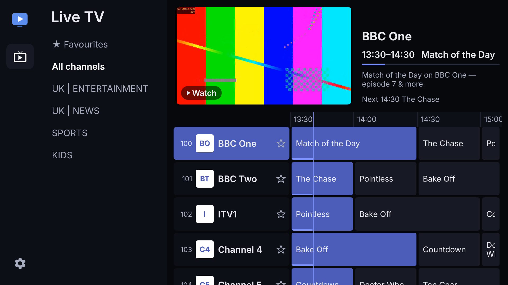
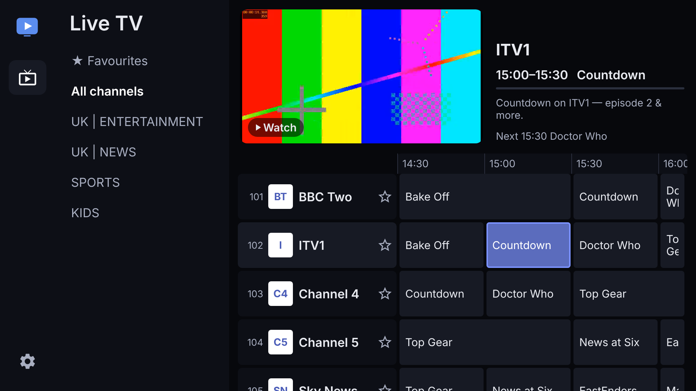
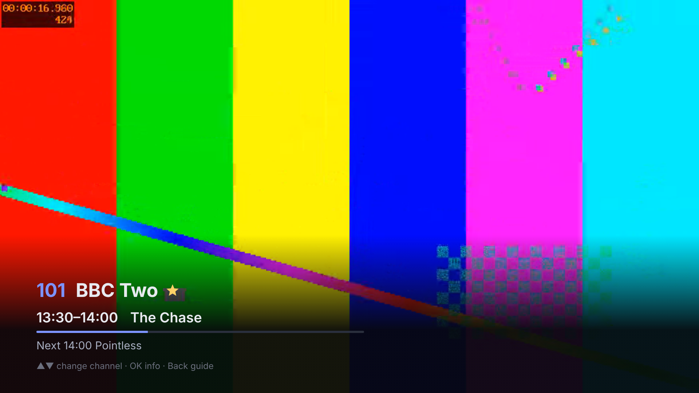
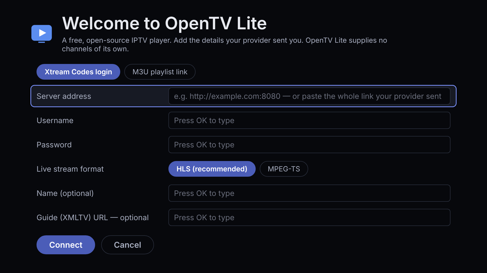
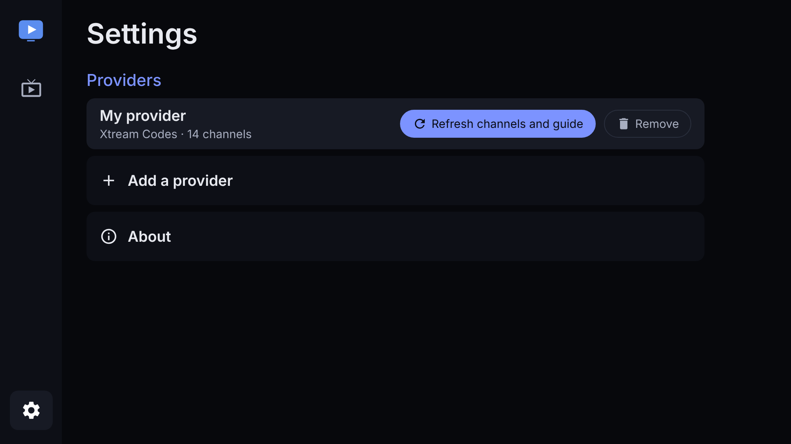
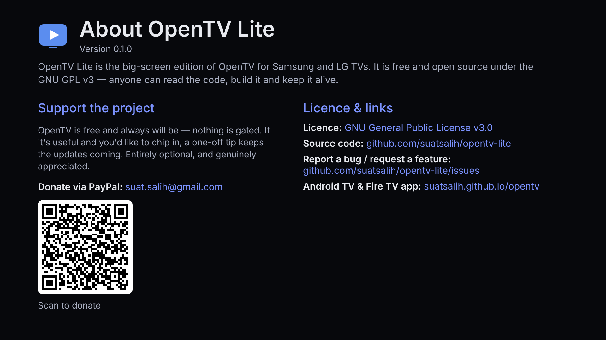

# OpenTV Lite

**A free, open-source IPTV player for Samsung (Tizen) and LG (webOS) TVs.**

OpenTV Lite is the big-screen edition of [OpenTV](https://github.com/suatsalih/opentv), the
Android TV / Fire TV app. It is one web app, written once, packaged for each TV platform.
No account. No subscription. No server of ours between you and your provider.

> **Support OpenTV** — it's free and always will be. If it's useful to you, you can chip in via
> **[PayPal](https://www.paypal.com/donate/?business=suat.salih@gmail.com&item_name=Support+OpenTV&no_recurring=0)**.
> Entirely optional; the app is never paywalled.

## What it does (v0.1)

- **Live TV** from Xtream Codes logins and M3U/M3U8 playlists — paste the whole link your
  provider sent and the login fills itself in
- **The OpenTV guide**: categories, a programme grid with a live preview, now/next info
- **XMLTV guide** from your provider (streamed, so huge guides work on a TV), cached between launches
- **Catch-up** of past programmes where your Xtream provider offers it
- **Favourites** (yellow button), channel up/down zapping, reopens on the last channel
- **Settings** to refresh or remove providers, or add another
- **About** with licence, links and the PayPal donation QR code

Coming next: movies and series, search, profiles, parental PIN, reminders and translations.

## Screenshots

Taken from the real app (`node tools/screenshots.mjs`), using the test provider that ships with
the repo — test card, made-up programmes.

The Live TV guide — categories, programme grid, and a live preview of the highlighted channel:



| Moving through the guide | Full screen, with the channel banner |
| :---: | :---: |
|  |  |
| **First launch: add your provider** | **Settings** |
|  |  |

About — licence, links and the PayPal donation QR code:



## What it deliberately does not do

Some OpenTV features are impossible for a TV web app, so Lite leaves them out: recording (DVR),
NAS/SMB storage, phone pairing and device sync (they need a server running on the TV),
self-updates (the TV stores handle updates), picture-in-picture and external players.
OpenTV Lite is a player only — you bring a service you already pay for.

## Supported TVs

| Platform | Models | Engine |
|---|---|---|
| Samsung Tizen | 2018 and newer (Tizen 4.0+) | Chromium 56+, AVPlay for video |
| LG webOS | 2018 and newer (webOS 4.0+) | Chromium 53+, `<video>` |

Everything that differs between platforms lives in `src/platform/` and `src/player/`. Adding
another web-based TV platform (Hisense VIDAA, Titan OS, Xbox) means a new adapter there, not
changes to the screens.

## Try it on your computer (no TV needed)

You need [Node.js](https://nodejs.org) 20 or newer, and [ffmpeg](https://ffmpeg.org) for the
test channels' video (Windows: `winget install ffmpeg`; macOS: `brew install ffmpeg`).

```bash
git clone https://github.com/suatsalih/opentv-lite.git
cd opentv-lite
npm install
npm approve-scripts esbuild   # only if npm warns that esbuild's install script was skipped
```

Then, in two separate terminal windows:

```bash
npm run mock     # window 1: a fake provider with 14 channels and a guide
npm run dev      # window 2: the app, at http://localhost:8080
```

The first `npm run mock` takes a minute or two to make the test video. Without ffmpeg it still
starts, with channels and a guide but no picture.

Open http://localhost:8080 in Chrome and use the keyboard as the remote:

| Remote | Keyboard |
|---|---|
| Arrows / OK | Arrow keys / Enter |
| Back | Escape |
| Channel up / down | `+` / `-` |
| Red / Green / Yellow / Blue | `r` / `g` / `y` / `b` |
| Info / Play-pause | `i` / Space |

To connect to the fake provider, type server `http://localhost:8090`, username `demo` and
password `demo` (just start typing on a highlighted field, or click it), then choose
**Connect**. On a TV, press OK on a field to open the TV's keyboard.

## Build for the TVs

```bash
npm run build    # dist/browser, dist/tizen, dist/webos
```

### Samsung (Tizen)

1. Install [Tizen Studio](https://developer.samsung.com/smarttv/develop/getting-started/setting-up-sdk/installing-tv-sdk.html)
   with the **TV Extensions** and create a **Samsung certificate** in Certificate Manager.
2. Package and sign: `tizen package -t wgt -s <your-profile> -- dist/tizen`
3. Install on the emulator or a TV in developer mode:
   `tizen install -n dist/tizen/OpenTVLite.wgt -t <device>`

### LG (webOS)

1. Install the webOS CLI: `npm install -g @webos-tools/cli`
2. Package: `ares-package dist/webos -o dist`
3. Install on the simulator, emulator or a TV in developer mode: `ares-install -d <device> dist/*.ipk`

## Testing without a TV

1. **Browser** — `npm run dev` (above). Covers the screens, navigation, providers and the guide.
2. **LG webOS TV Simulator** — part of LG's [webOS TV SDK](https://webostv.developer.lge.com/develop/tools/simulator-introduction)
   (Windows, macOS, Linux). Runs the real LG app: `ares-launch -s <version> dist/webos`.
3. **Samsung Tizen TV Emulator** — part of Tizen Studio. Runs the real Samsung app; it needs a
   PC with hardware virtualisation, and its video playback is limited.
4. **A real TV** — any Samsung or LG TV in developer mode. The only way to be sure a given
   provider's streams play smoothly.

### Automated checks

```bash
npm run check                     # typecheck, unit tests, all three builds
MOCK_CODEC=vp9 npm run mock &     # fake provider (VP9 so headless Chromium can decode it)
npm run dev &
node tools/e2e.mjs                # acceptance run with the remote, Xtream
node tools/e2e.mjs --m3u          # the same with an M3U playlist
```

The acceptance run drives the app only with remote keys and saves a screenshot of every step
to `e2e-shots/`. `node tools/screenshots.mjs` (same setup) regenerates the README screenshots. Real providers send H.264, which TVs decode in hardware but the open-source
Chromium used for automated tests cannot — hence the VP9 mode of the fake provider.

## How it relates to OpenTV

The provider logic (M3U, XMLTV, Xtream), the guide's behaviour and the look are ported from
OpenTV's Android code; the Android-only parts are rewritten for the web. Both apps are
GPL-3.0-or-later, so anyone can fork either and keep it alive.

## Licence

[GPL-3.0-or-later](LICENSE).
